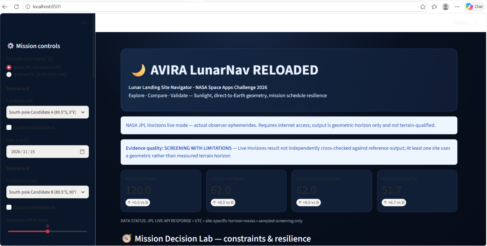
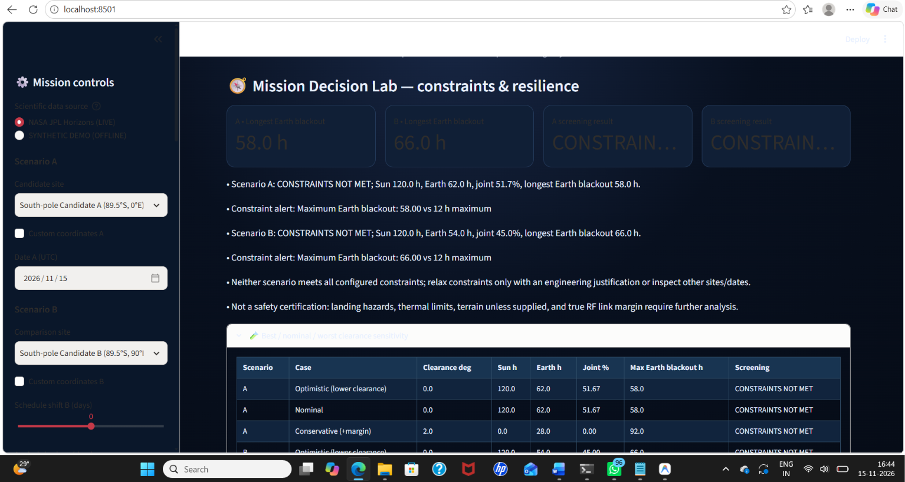
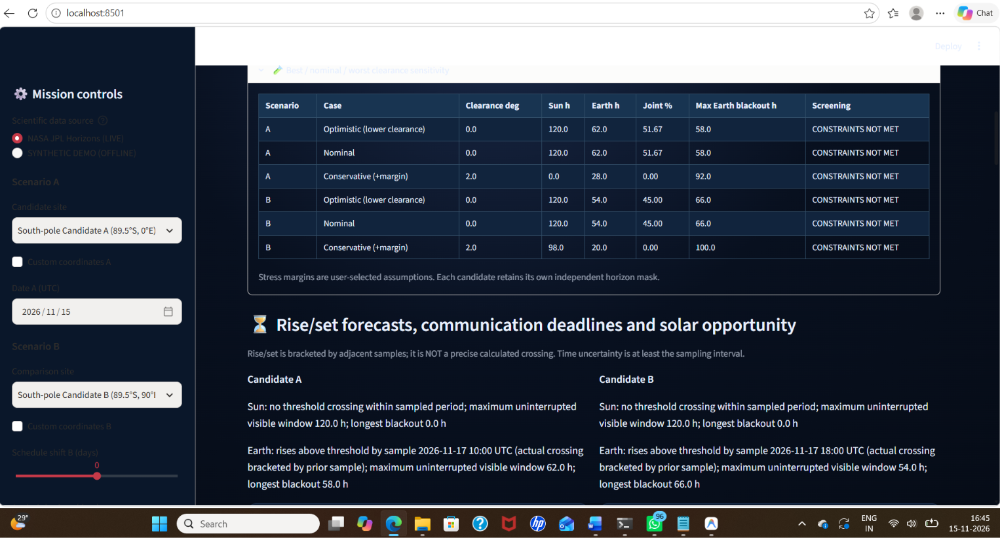
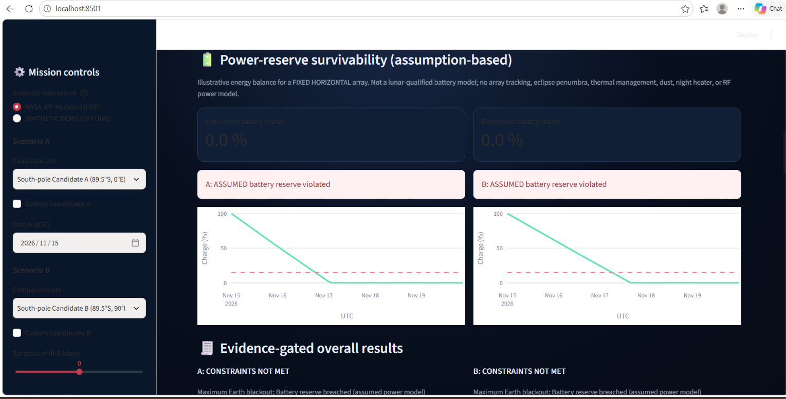

# AVIRA LunarNav RELOADED — Lunar Landing Site Navigator

**NASA Space Apps Challenge 2026 | Besançon, France | 14–15 November 2026**

- **Challenge:** Lunar Landing Site Navigator
- **Team:** [AVIRA_LunarNav_RELOADED](https://www.spaceappschallenge.org/2026/find-a-team/avira_lunarnav_reloaded/)
- **Local Event:** Besançon, France (virtual participation from India)
- **Status:** Working Python/Streamlit research prototype — not flight-qualified.

## Team Members

| Name | GitHub |
|---|---|
| Rahul Ashokrao Dhapatkar | [@raddy23](https://github.com/raddy23) |

## The Problem

Lunar south-pole landing plans must consider low Sun angles,
changing Earth visibility, terrain restrictions, and power
constraints. A mission delay may change whether a selected
site meets its requirements.

## Our Solution

**AVIRA LunarNav RELOADED** provides an explainable mission
screening workflow:

**INPUT → DETECT → EXPLAIN → RECOVER → VERIFY**

1. **Input:** Select lunar sites, dates and engineering thresholds.
2. **Detect:** Evaluate Sun/Earth geometry and communication windows.
3. **Explain:** Identify blackout and battery-reserve constraint failures.
4. **Recover:** Compare alternative sites, dates and fault scenarios.
5. **Verify:** Review results, assumptions and supporting evidence.

### Implemented Features

- Python/Streamlit interactive dashboard
- NASA/JPL Horizons API client and offline synthetic mode
- Two-site comparison and landing-date what-if analysis
- Sun/Earth visibility graphs
- Communication-blackout analysis
- Simplified battery and power-reserve screening
- Fault injection and engineering constraint checking
- Interactive procedural 3D visualization
- CSV and evidence export
- Automated Python testing

## Actual Working Prototype Results

**Environment:** Windows, Python 3.12, Streamlit

**Automated test result: 49 PASSED, 0 FAILED, 2 WARNINGS**

### Screenshot 1 — Working Dashboard



### Screenshot 2 — Actual Application Output



### Screenshot 3 — Actual Application Output



### Screenshot 4 — Actual Application Output



### Complete Results Gallery

[View all 10 screenshots](AVIRA_LunarNav_RELOADED_v4_3_Verification_Kit/AVIRA_LunarNav_RELOADED_v4_2/Results)

### Example Landing Site Comparison

**Evaluation:** 15–20 November 2026; 120-hour window.

| Parameter | Candidate A | Candidate B |
|---|---:|---:|
| Coordinates | 89.5°S, 0°E | 89.5°S, 90°E |
| Sun visibility | 120 h | 120 h |
| Earth visibility | 62 h | 54 h |
| Joint visibility | 62 h | 54 h |
| Joint percentage | 51.67% | 45.00% |
| Longest Earth blackout | 58 h | 66 h |
| Illustrative minimum battery | 0% | 0% |
| Overall result | NOT MET | NOT MET |

**Engineering finding:** Candidate A provides eight more
sampled joint-visibility hours, but both candidates fail
the configured overall constraints.

The prototype explains these failures instead of
incorrectly certifying either location as safe.

**Scientific limitation:** These are actual application
outputs; independent cross-validation against preserved
raw NASA/JPL Horizons responses is still pending.

## Final 7-Slide NASA Presentation

### [DOWNLOAD OUR FINAL POWERPOINT](AVIRA_NASA_Final.pptx)

**Presentation contents:**
- Lunar landing mission-planning challenge
- Existing tools and project differentiation
- INPUT → DETECT → EXPLAIN → RECOVER → VERIFY
- Working Python/Streamlit prototype
- Analysis results and engineering constraints
- 3D geometry and conceptual lunar animation
- Impact, limitations and future development

### Conceptual Animation


*AI-generated conceptual illustration; not actual NASA
footage or a flight-validated simulation.*

## Existing Tools and Our Differentiation

NASA/JPL Horizons, NASA Moon Trek and LROC QuickMap
already provide important scientific data and lunar
visualization capabilities.

Our contribution is the integration of site/date
comparison with explainable constraint failures,
mission-delay scenarios, alternative evaluation,
fault testing and evidence-aware screening.

No superiority over professional NASA tools is claimed.

## NASA Data and Resources

- [NASA/JPL Horizons](https://ssd.jpl.nasa.gov/horizons/)
- [Horizons API](https://ssd-api.jpl.nasa.gov/doc/horizons.html)
- [NASA Moon Trek](https://trek.nasa.gov/moon/)
- [LROC QuickMap](https://quickmap.lroc.asu.edu/)
- [NASA LOLA](https://lola.gsfc.nasa.gov/)

The code includes a Horizons live-query pathway.
Raw NASA-derived results have not been independently
cross-validated in the submitted evidence.

Real NASA LOLA terrain is not currently integrated.

## Use of AI / SI Tools — Required Disclosure

OpenAI ChatGPT assisted with software architecture,
Python implementation, unit tests, documentation,
troubleshooting and presentation preparation.

AI image-generation tools assisted with conceptual
lunar artwork and lander animation. These are illustrations,
not scientific observations or NASA photographs.

Optional scikit-learn outlier detection is exploratory
and is not a validated mission-safety prediction system.

The team remains responsible for testing and validation.

## Deliverables

- **Repository:** [Official GitHub project](https://github.com/2026-NASA-Space-Apps-Besanzon/AVIRA_LunarNav_RELOADED)
- **7-slide presentation:** [AVIRA_NASA_Final.pptx](AVIRA_NASA_Final.pptx)
- **Screenshots:** [10 prototype results](AVIRA_LunarNav_RELOADED_v4_3_Verification_Kit/AVIRA_LunarNav_RELOADED_v4_2/Results)
- **Source and tests:** [Python project](AVIRA_LunarNav_RELOADED_v4_3_Verification_Kit/AVIRA_LunarNav_RELOADED_v4_2)

The Streamlit app runs locally at http://localhost:8501,
which is not a publicly hosted demonstration URL.

## How to Run

Open the project directory:

`AVIRA_LunarNav_RELOADED_v4_3_Verification_Kit/AVIRA_LunarNav_RELOADED_v4_2`

Using Python 3.12:

```powershell
py -3.12 -m venv C:\nasaenv
C:\nasaenv\Scripts\python.exe -m pip install --only-binary=:all: -r requirements.txt
C:\nasaenv\Scripts\python.exe -m pytest -q
C:\nasaenv\Scripts\python.exe -m streamlit run app.py
```

**Windows compatibility:** An Application Control policy
blocked the PyArrow DLL on the test machine. The repository
includes `AVIRA_LunarNav_RELOADED_app_no_pyarrow.py`,
which provides an alternative table-rendering method.

To use it when needed:

```powershell
C:\nasaenv\Scripts\python.exe -m streamlit run AVIRA_LunarNav_RELOADED_app_no_pyarrow.py
```

Do not disable Windows security policies.

## Scientific Limitations

- Prototype only, not flight-qualified software.
- Actual lunar terrain occlusion is not fully modeled.
- Sun elevation is not a verified solar-power model.
- Earth visibility is not a complete RF link budget.
- Battery reserves depend on simplified assumptions.
- Synthetic data are distinguished from NASA measurements.
- Raw Horizons scientific validation remains pending.

## Final Submission Checklist

- [x] Project description completed in English
- [x] Team name and GitHub details provided
- [x] AI/SI usage disclosure completed
- [x] Working Streamlit application demonstrated
- [x] 49 automated tests passed
- [x] Python source code and tests uploaded
- [x] Actual application screenshots uploaded
- [x] Final 7-slide PowerPoint uploaded
- [x] GitHub repository and presentation links available
- [ ] Independently validate scientific outputs against raw NASA data
- [ ] Confirm links work without signing into GitHub
- [ ] Submit project on the official NASA Space Apps website
- [ ] Confirm "Submit for Judging" success message

**Submission deadline:** 15 November 2026, 23:59 CET

**Team:** AVIRA_LunarNav_RELOADED  
**Participant: ** Rahul Ashokrao Dhapatkar, Pune, India
**Local Event:** Besançon, France

